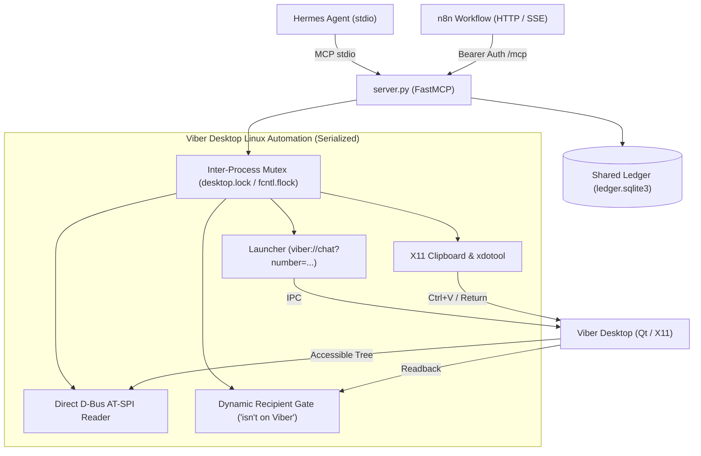

# Viber Desktop MCP Server for Linux

[](https://modelcontextprotocol.io)
[-orange.svg)](https://www.linux.org)
[](https://www.python.org)
[](LICENSE)

A production-ready **Model Context Protocol (MCP)** server providing reliable, bidirectional automation for **Viber Desktop on Linux**.

Enables AI agents (such as **Hermes Agent**, **Claude Desktop / Claude Code**, and **n8n automation pipelines**) to search contacts, open chats, read conversation history, prepare verified drafts in any language, and send messages with strict operator oversight.

---

## ⚡ Highlights

- **⚡ Zero-OCR Instant Reading**: Reads visible conversation history and composer state directly via **Linux AT-SPI accessibility over D-Bus** in milliseconds, with 100% exact character fidelity.
- **🌐 Full Multilingual & Unicode Support**: Native clipboard injection (`xclip` + `xdotool`) guarantees flawless typing of Cyrillic characters (`ї`, `є`, `ґ`, `І`), emojis, and non-ASCII scripts.
- **📞 Universal Number Addressing**: Switch to any phone number or saved contact instantly using Viber's native protocol launcher (`viber://chat?number=...`).
- **🔒 Race-Condition Safe**: Built-in sequential execution lock (`asyncio.Lock`) ensures safe, serial execution on the single shared desktop GUI.
- **🛡️ Sandboxing & Daemon Compatibility**: Transparently works inside isolated systemd services (e.g. `PrivateTmp=true`) via automated user-session runner delegation.
- **👥 Dynamic Address Book**: Persistent `contacts.json` with fuzzy name/surname/alias lookup and dynamic contact saving (`save_contact`).
- **🛑 Strict Safety Gate**: Draft creation (`put_draft`) is separated from sending (`send_message`), requiring explicit operator confirmation before dispatching.

---

## 🛠️ System Requirements

- **Operating System**: Linux (Debian 12+, Ubuntu 22.04+, Arch, Fedora, etc.)
- **Display Server**: X11 (or XWayland / xrdp virtual display, e.g. `:10`)
- **Viber Desktop**: Official Viber Desktop for Linux (tested on Viber 27.3.x)
- **Python**: `>= 3.11`
- **System Packages**:
  ```bash
  sudo apt-get update && sudo apt-get install -y \
      xclip \
      xdotool \
      x11-utils \
      python3-dbus \
      python3-pil
  ```

---

## 📦 Installation

```bash
git clone https://github.com/vivajarvis777-dev/viber-mcp-linux.git
cd viber-mcp-linux

# Install using uv (recommended)
uv sync

# Or using standard venv + pip
python3 -m venv .venv
source .venv/bin/activate
pip install -e .
```

Copy the example contacts configuration:
```bash
cp contacts.example.json contacts.json
```

---

## ⚙️ Configuration & MCP Client Setup

### 1. Hermes Agent (`~/.hermes/config.yaml`)

Add the server to your Hermes MCP configuration:

```yaml
mcp_servers:
  viber:
    command: /path/to/viber-mcp-linux/.venv/bin/python
    args:
      - /path/to/viber-mcp-linux/server.py
    timeout: 60
    connect_timeout: 15
    env:
      DISPLAY: :10.0
      XDG_SESSION_TYPE: x11
      XDG_RUNTIME_DIR: /run/user/1000
      DBUS_SESSION_BUS_ADDRESS: unix:path=/run/user/1000/bus
      VIBER_LAUNCHER: /path/to/launch-viber
    trust: full
    supports_parallel_tool_calls: false
    tools:
      include:
        - health
        - list_contacts
        - find_contact
        - save_contact
        - open_chat
        - read_open_chat
        - put_draft
        - send_message
```

### 2. Claude Desktop (`claude_desktop_config.json`)

```json
{
  "mcpServers": {
    "viber": {
      "command": "/path/to/viber-mcp-linux/.venv/bin/python",
      "args": [
        "/path/to/viber-mcp-linux/server.py"
      ],
      "env": {
        "DISPLAY": ":0",
        "DBUS_SESSION_BUS_ADDRESS": "unix:path=/run/user/1000/bus",
        "VIBER_LAUNCHER": "/opt/viber/Viber"
      }
    }
  }
}
```

### 3. n8n Workflow Automation (Native HTTP/SSE Transport)

Viber MCP provides native **Streamable HTTP** and **Server-Sent Events (SSE)** transports alongside stdio, allowing n8n workflows to interact directly with Viber Desktop over authenticated HTTP.

#### Starting the HTTP/SSE Server

```bash
# Generate a secure random token
export VIBER_MCP_HTTP_TOKEN="your-secure-random-bearer-token"
export VIBER_MCP_TRANSPORT="http"   # or "sse" / "streamable-http"
export VIBER_MCP_HOST="127.0.0.1"    # default: 127.0.0.1
export VIBER_MCP_PORT="8000"         # default: 8000

# Outbound sending enabled when explicitly allowed (default: 0)
export VIBER_ENABLE_SEND="1"

# Run single unified server in HTTP/SSE mode:
uv run server.py --transport http --port 8000
# (linux_server.py is also available as a backward-compatible decorator)
```

#### Configuring n8n MCP Client Node

1. In n8n, add an **MCP Client Node** (or MCP Tool in AI Agent workflows).
2. Choose your transport connection:
   - **Streamable HTTP (Recommended)**: `http://127.0.0.1:8000/mcp`
   - **Server-Sent Events (SSE)**: `http://127.0.0.1:8000/sse`
3. Add Authentication Header:
   - Header Name: `Authorization`
   - Header Value: `Bearer <VIBER_MCP_HTTP_TOKEN>`
   *(Requests without this header or with an invalid token receive `401 Unauthorized`)*

#### Health Check & Monitoring

You can inspect server status at any time via curl or monitoring tools:
```bash
curl -H "Authorization: Bearer $VIBER_MCP_HTTP_TOKEN" http://127.0.0.1:8000/health
```
Response (no GUI actions performed):
```json
{
  "platform": "linux",
  "read_available": true,
  "send_enabled": false,
  "viber_window_found": true
}
```

#### Minimal n8n Workflow

A recommended minimal automated pipeline:
```
[Webhook / CRM Trigger]
         │
         ▼
[MCP: health] ───────────────► Check read_available and viber_window_found
         │
         ▼
[MCP: list_contacts] ────────► Resolve recipient phone or private alias
         │
         ▼
[MCP: open_chat] ────────────► Navigate to recipient and verify subscriber gate
         │
         ▼
[MCP: send_message] ─────────► Automated send (fail-closed, duplicate-protected)
```

#### Fail-Closed Pipeline Safety Guarantees

- **Single Unified Server**: Both Hermes Agent (stdio) and n8n (HTTP/SSE) utilize the exact same codebase (`server.py` -> `viber_mcp_service.py`), canonical 8-tool set, and environment.
- **Inter-Process File Mutex (`desktop.lock`)**: File-based `fcntl.flock` mutex serializes all GUI operations across separate processes (Hermes stdio process and n8n HTTP server). Only one UI interaction touches the Viber window at a time; concurrent requests wait with bounded timeout or return a clear `viber_busy` status.
- **Shared Anti-Duplicate Ledger (`ledger.sqlite3`)**: The SQLite3 ledger tracks message digests `(recipient, text)` in a single shared file. Re-sending identical text to the same recipient is blocked regardless of which client initiated it (Hermes or n8n).
- **Bearer Token Guard**: All HTTP endpoints (`/health`, `/mcp`, `/sse`, `/messages/`) enforce `VIBER_MCP_HTTP_TOKEN` (unauthorized requests return `401 Unauthorized`).
- **Recipient Gate**: Before sending, the server verifies that the recipient is an active Viber user. If Viber responds with *"isn't on Viber"* / *"not in your contact list"* or identity verification fails, the send is immediately rejected. Dynamic: valid new numbers pass without manual whitelisting.
- **Circuit Breaker**: Outbound sending is disabled unless `VIBER_ENABLE_SEND=1` is explicitly configured in the environment.
- **Hermes stdio Compatibility**: The default stdio mode remains completely untouched for Hermes Agent.

---

## 🧰 Available MCP Tools

| Tool | Mode | Description |
|---|---|---|
| `health()` | Read-only | Returns Viber window presence, AT-SPI accessibility connectivity, and send status without performing any GUI actions. |
| `list_contacts()` | Read-only | Returns all known address book contacts and their aliases from `contacts.json`. |
| `find_contact(query)` | Read-only | Search contacts by name, surname, alias, or phone number. Automatically normalizes direct phone numbers. |
| `save_contact(phone, name, aliases)` | Write | Saves or updates contact metadata into `contacts.json` dynamically during runtime. |
| `open_chat(to)` | Action | Opens the conversation for any phone number (`+380...`), contact name, or alias (protected by mutex & recipient gate). |
| `read_open_chat(to?)` | Read-only | Reads visible message bubbles from the currently open or specified chat via AT-SPI (protected by mutex). |
| `put_draft(to, text)` | Action | Pastes verified text into the chat composer via clipboard and validates it with exact AT-SPI readback (protected by mutex). |
| `send_message(to, text, approval_token)` | Destructive | Sends the prepared message after explicit operator approval, clears composer, and verifies delivery in chat history. |

---

## 🏗️ Architecture & How It Works



### 1. Direct D-Bus Accessibility (No OCR Latency)
Traditional GUI automation relies on screenshots and computer vision OCR, which are slow, error-prone, and cannot distinguish sender from recipient reliably. This MCP server communicates directly with the **AT-SPI D-Bus accessibility registry** (`org.a11y.atspi.Accessible` and `org.a11y.atspi.Text`). It reads chat history in under 50ms with 100% character precision.

### 2. Solving Linux Daemon Isolation (`PrivateTmp=true`)
When running as a background systemd service, agents often have `PrivateTmp=true` enabled. However, Viber Desktop creates its single-application IPC socket in the host's `/tmp/Viber-0-3eb`. This MCP server automatically detects mount namespace isolation and transparently executes the launcher command via `systemd-run --user` inside the user session, switching chats in ~1.2s without hanging.

### 3. Native Conversation Draft Preservation
Viber Desktop stores unsent composer text in memory per conversation. When switching between multiple contacts, drafts are preserved independently without leaking between chats.

---

## 🔒 Security & Safety Best Practices

1. **Human-in-the-Loop Safeguard**: The `send_message` tool requires an `approval_token` (defaulting to `"CONFIRMED"` only after explicit chat confirmation), ensuring the agent never sends unintended messages.
2. **Privacy First**: `contacts.json` and screenshot artifacts (`private/`) are ignored in `.gitignore` by default to prevent leaking personal phone numbers.
3. **Execution Locking**: The global async mutex prevents parallel commands from interleaving during clipboard operations or window switching.

---

## 📄 License

This project is licensed under the [MIT License](LICENSE).
